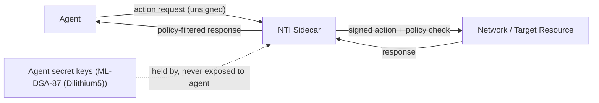

# NTI-1 Specification: Neutral Trust Infrastructure - Standard 1

**License:** CC BY 4.0 | **Version:** 1.0.0-draft

> **Status (read first).** This is a *draft proposal* (version 1.0.0-draft) under public discussion, principally in the W3C AI Agent Protocol Community Group (public-agentprotocol). It is **not a ratified standard** and not the output of any accredited standards-development organization; "Standard 1" and "NTI Foundation" are working names of this draft project, not accreditation claims. Normative language (MUST/SHOULD) should be read as proposal language pending community review.

## Table of Contents

1. [Introduction](#1-introduction)
2. [Terminology](#2-terminology)
3. [The 5 Pillars & Data Structures](#3-the-5-pillars--data-structures)
4. [Compliance Levels](#4-compliance-levels)
5. [Testable Requirements](#5-testable-requirements)
6. [Runtime Halt & Revocation (LGD State Machine)](#6-runtime-halt--revocation-lgd-state-machine)
7. [Ecosystem Interoperability (ASL Conformance Kit)](#7-ecosystem-interoperability-asl-conformance-kit)
8. [Reference Implementation](#8-reference-implementation)
9. [Certification Process](#9-certification-process)
10. [Governance](#10-governance)
11. [Security Considerations](#11-security-considerations)
12. [Appendix](#12-appendix)

---

## 1. Introduction

This document specifies NTI-1, the foundational open standard for post-quantum, zero-trust governance of autonomous AI agents. NTI-1 defines formal technical requirements across five core pillars, establishing verifiable trust, non-repudiation, and BFT multi-agent consensus for enterprise deployment environments.

## 2. Terminology

* **Agent:** An autonomous software system that perceives, decides, and acts.
* **Action:** A discrete operation executed by an agent with external effect.
* **Capability:** An explicit permission granted to an agent to perform a specific class of actions.
* **Caveat:** A condition attached to a capability (e.g., Expires, ValueLimit).
* **Trust Engine:** The component that evaluates an action against policy.
* **Append-only hash chain:** A sequence of events in which each event commits to its predecessor's hash. This is the Pillar 4 audit trail.
* **Merkle accumulator:** A tree whose root commits to a set and changes on revocation. This is the Section 6 revocation registry.
* **PQC:** Post-Quantum Cryptography.
* **Dilithium5:** CRYSTALS-Dilithium5, a NIST Level 5 post-quantum signature algorithm.

## 3. The 5 Pillars & Data Structures

### 3.1 Pillar 1: Principal-Bound Identity

**Requirement:** Every agent MUST possess a principal-bound identity that cryptographically ties its actions to a responsible legal party (human or enterprise).

**Specification:**

* Non-repudiable identifiers MUST be tied to the responsible legal party. The agent identifier is assigned by the responsible party (not delegated) and can be unique without coordinating across central authorities (e.g., via cryptographic UUIDs or decentralized identifiers).
* The responsible party does NOT have access to the agent's secret key; the agent's secret key is generated and retained securely by the NTI sidecar.
* Every action request MUST be signed by the agent's secret key delegated by or bound to the principal.
* Identity claims MUST NOT be revocable without an auditable record. Revoking an identity claim means revoking the authentication secret key associated with that delegation, not extinguishing or erasing the legal identity of the responsible principal.

**Rationale:** An AI agent is code and lacks legal standing. Cryptographic identity must bind agent actions to a responsible legal principal.

### 3.2 Pillar 2: Governance

**Requirement:** Every agent action MUST be evaluated against a policy before execution.

**Specification:**

* Agents possess zero inherent permissions. All capabilities MUST be granted.
* Capability grants MUST support at least these caveats: `Expires`, `MaxExecutions`, `ValueLimit`, `PathRestricted`.
* `Expires` is an RFC 3339 instant evaluated against the verifier's clock; once passed, the grant MUST be denied (not paused). `MaxExecutions` is a hard count enforced across concurrent calls; the (N+1)th execution under `MaxExecutions = N` MUST be denied. Renewal issues a new grant and MUST NOT extend an existing one in place.
* Policy evaluation MUST return a decision (Allow or Deny) with a reason.
* Policy evaluation MUST NOT depend on the requester's authentication; policy evaluation depends strictly on the capability presentation, attenuation caveats, and validity constraints, preventing proxy bypass and confused deputy attacks.
* Denied actions MUST NOT be executed under any circumstances.

### 3.3 Pillar 3: Consensus

**Requirement:** In multi-agent systems, decisions affecting high-value actions MUST require Byzantine Fault Tolerant consensus.

**Specification:**

* Multi-agent decisions MUST support threshold signature collection.
* Each vote MUST contain: `(voter_id, request_id, decision, outcome_hash, signature)`.
* The system MUST verify: no duplicate votes, threshold agreement, and matching outcome hashes.
* Duplicate votes from a single `voter_id` MUST NOT satisfy the threshold (see `conformance/issue-18/duplicate_vote.json`).
* The threshold MUST be configurable (RECOMMENDED: 2/3 majority).

### 3.4 Pillar 4: Audit

**Requirement:** Every evaluated action MUST be recorded in a tamper-evident audit trail.

**Specification:**

* Audit records MUST form an append-only SHA-256 hash chain (an append-only hash chain, not a Merkle tree; see Terminology and Section 6 for the Merkle accumulator).
* The "parent hash" is defined as the SHA-256 hash of the immediate previous event in the append-only hash chain. The root genesis event defines `parent_hash = "0" * 64`.
* Each audit event MUST include: Event ID, Agent ID, Action hash, Decision, Reason, Timestamp, Parent hash, Event hash.
* The `Event hash` MUST be SHA-256 over the RFC 8785 (JCS) canonical JSON of the ordered fields above. Implementations MUST NOT build the preimage by joining fields with a delimiter: a field value that contains the delimiter makes two different events produce the same preimage (see `conformance/issue-18/preimage_reproducibility.json`).
* Tampering with any past event MUST cause verification to fail (see `conformance/issue-18/tamper_detection.json`).
* Truncation detection relies on anchoring the Merkle accumulator root and external verification: a truncated log MUST NOT be accepted as complete. Because link verification alone passes any valid prefix, completeness MUST be anchored to the published Merkle accumulator root, expected chain length, or externally witnessed final head (see `conformance/issue-18/truncation.json` and T-4.1).

### 3.5 Pillar 5: Persistence

**Requirement:** Agent state and audit trails MUST persist across restarts with self-verifying integrity.

**Specification:**

* Persistent agent state consists strictly of committed audit chain headers, identity key material references, capability tokens, and cryptographic ledger checkpoints. Incomplete transactions, interrupted executions, and uncommitted in-flight operations MUST be forgotten or rolled back cleanly upon restart, and MUST NOT be persisted or resumed as valid state.
* On reload, the system MUST verify the integrity of the audit chain.
* Agent identity secret keys MUST be persisted securely (HSM support at Level 3).
* Persistent state MUST be exportable and importable.

### 3.6 Data Structures

This section defines the canonical data structures for delegations and invocations within NTI-1.

#### 3.6.1 Capability Delegation

A delegation issues authority from an issuer principal to a subject agent, attaching attenuation rules and caveats.

```json
{
  "delegation_id": "del-8f2a1b9c-44e2-411a-8bb7-d4f107f9104a",
  "issuer": "did:nti:principal:org-corp-enterprise-99",
  "subject": "did:nti:agent:ag-8834-worker-finance",
  "resource": "arn:nti:resource:ledger/treasury/*",
  "actions": [
    "transfer",
    "query_balance"
  ],
  "attenuation": {
    "expires_at": "2026-11-06T00:00:00Z",
    "valid_after": "2026-11-05T00:00:00Z",
    "max_executions": 50,
    "value_limit": {
      "currency": "USD",
      "max_amount_per_action": 10000,
      "total_cumulative_limit": 50000
    },
    "path_restricted": [
      "/accounts/operations/*"
    ]
  },
  "revocation_registry_uri": "urn:nti:revocation-registry:merkle-root",
  "algorithm": "CRYSTALS-Dilithium5",
  "issuer_signature": "3045022100e4...dsa87_signature_bytes..."
}
```

#### 3.6.2 Capability Invocation

An invocation passes capability delegation chains alongside concrete operation arguments, explicitly conveying resource references as arguments to prevent confused deputy attacks.

```json
{
  "invocation_id": "inv-20261105-9988-410a-b31c-ef80918ca120",
  "target_service": "arn:nti:service:treasury-dispatcher",
  "operation": "transfer",
  "arguments": {
    "source_resource_ref": "arn:nti:resource:ledger/treasury/operating-account",
    "destination_resource_ref": "arn:nti:resource:ledger/treasury/settlement-account",
    "amount": 2500,
    "currency": "USD",
    "memo": "Supplier settlement #48102"
  },
  "delegation_chain": [
    "del-8f2a1b9c-44e2-411a-8bb7-d4f107f9104a"
  ],
  "invoker_id": "did:nti:agent:ag-8834-worker-finance",
  "timestamp": "2026-11-05T14:30:00Z",
  "algorithm": "CRYSTALS-Dilithium5",
  "invoker_signature": "3046022100c8...agent_secret_key_signed_invocation..."
}
```

### 3.7 The NTI Sidecar

The NTI sidecar sits between the agent and the network. It addresses two primary threats: agents going rogue and agents failing to keep secrets. The sidecar holds the agent's secret keys, signs on behalf of the agent, and enforces a policy on what goes in and out of the agent. The agent itself never has access to the raw secret keys, protecting it from prompt injection attacks that attempt to exfiltrate credentials.



## 4. Compliance Levels

* **Level 1 (Basic, Audit-Only Profile):** Pillars 1 and 4 REQUIRED. This profile records and verifies decisions but does not evaluate policy (Pillar 2); it MUST be labelled Audit-Only so the absence of governance is explicit rather than implied. Suitable for internal tooling.
* **Level 2 (Standard):** All 5 Pillars REQUIRED. Suitable for regulated industries.
* **Level 3 (Enterprise):** All 5 Pillars + HSM key storage, SOC 2 Type II, ISO 27001, and 99.99% availability SLA.

## 5. Testable Requirements

(Implementation MUST pass these tests to claim compliance)

* **T-1.1 (Identity):** Submit action with no signature. Result: MUST be Deny.
* **T-2.1 (Governance):** Submit action with expired capability. Result: MUST be Deny.
* **T-3.1 (Consensus):** Multi-agent action without threshold. Result: MUST be Deny.
* **T-4.1 (Audit):** Execute 100 actions. Result: Chain length MUST equal 100.
* **T-5.1 (Persistence):** Restart system. Result: Audit chain MUST be preserved.
* **T-6.1 (Revocation):** Submit action referencing a revoked delegation token or identity secret key. Result: MUST be Deny.
* **T-6.2 (Use before valid start time):** Submit action before the capability's `valid_after` instant has been reached. Result: MUST be Deny.
* **T-6.3 (Unauthorized action):** Submit action requesting an operation outside the capability grant's delegated actions or path restrictions. Result: MUST be Deny.

## 6. Runtime Halt & Revocation (LGD State Machine)

To enforce continuous runtime revocation without corrupting atomic execution, NTI-1 standardizes the LGD (Lifecycle Governance Domain) state machine sequence:

`REGISTERED -> GATE_PASSED -> ACTIVE -> ANOMALY -> PAUSE -> ROLLBACK -> REVERIFY -> RESUMED`

> **Reference (draft for comment).** The state-machine logic and the `resume_basis` field below are drawn from the *NTI x LGD transition-contract spec - v0.1.4*, prepared by Xinghua Zhao (2026-10-30). That document is **draft for comment and explicitly "not agreed" by either side** (see its sec.0.1 / sec.0.3); it carries no standards-body weight outside its originating thread. It is linked here as a working reference for implementers, not as a ratified normative annex. Canonical, byte-for-byte copy: <https://github.com/zhaoxinghua09-cell/nti-lgd-transition-contract/blob/679b6e4445fb84e26cc051cda3b0ebed3d5526c3/nti-transition-contract-spec-v0.1.4.md>

### 6.1 Fail-Closed Semantics (`incomplete_check`)

When a revocation registry or trust authority is unreachable, the system MUST enforce fail-closed execution.

**Revocation Registry vs. Trust Registry:**
A **Revocation registry** is an authenticated Merkle accumulator publishing cryptographic proofs of revoked delegations and invalidated auth secret keys (dynamic status of negative claims). In contrast, a **Trust registry** publishes authoritative root public keys, issuer legal identity mappings, and governance schemas (static or epoch-based root-of-trust identity and admission authority).

If a status check cannot be completed, the runtime MUST emit an `incomplete_check` and halt. The `reason` field MUST be set to one of the following:

* `tryLater`: Temporary network unavailability.
* `not_authoritative`: Queried registry cannot provide authoritative status.
* `internal_error`: Unhandled exception during status resolution.

When `incomplete_check` is encountered, the runtime sidecar MUST NOT allow the action to proceed.

### 6.2 Resume Receipt - the `resume_basis` field

When the `REVERIFY -> RESUMED` edge is taken, the RESUME receipt MUST carry a `resume_basis` value from the closed set:

* `evidence` - the registered restore condition was verified in full (evidence list, verifier role, validity window): the condition that caused the halt was confirmed restored.
* `exemption` - an accountability layer accepted the risk; the reason is recorded, **not evaluated**. Both values permit `RESUMED`.

The field adds to the RESUME receipt only; it does not add, remove, or rename a state, and the sec.6 transition line is unchanged.

**Exemption boundaries (MUST be in the schema):**

* `exemption_covers = policy_violation`
* `exemption_does_not_cover = authority_revoked, authority_not_determined`

`authority_revoked` is the issuing authority's decision (only the direct delegator who granted the authority can revoke it), not the executing side's; a signed justification cannot un-revoke it. `authority_not_determined` is an absence of information (registry unreachable / stale root), not a judgment; a signature cannot convert "unknown" into "known". An exemption MUST NOT buy back the fail-closed property: `authority_revoked` and `authority_not_determined` MUST NOT be resumed on `exemption`.

### 6.3 Normative References — LGD Transition Contract

The state-machine sequence, the `resume_basis` field, and the `incomplete_check` reason set defined in §6.1–§6.2 are normatively specified in the *NTI x LGD transition-contract spec — v0.1.4* (Xinghua Zhao, 2026-10-30). Canonical, byte-for-byte copy:

* **Specification:** <https://github.com/zhaoxinghua09-cell/nti-lgd-transition-contract/blob/679b6e4445fb84e26cc051cda3b0ebed3d5526c3/nti-transition-contract-spec-v0.1.4.md>
* **Reference implementation:** `lgd-medai-demo` (`lgd_medai_demo.py`, zero-dependency, independently verifiable via VERIFICATION.md) — <https://github.com/zhaoxinghua09-cell/lgd-medai-demo>

Tymofii (aeoess) has contributed **candidate** test vectors for the two finish-or-stop contracts `FINISH_THEN_STOP` and `STOP_AT_CHECKPOINT` in [PR #206](https://github.com/Agent-Authority-Conformance/aps-conformance-suite/pull/206) to the APS conformance suite, derived from v0.1.4 and the public-agentprotocol thread (0108/0088/0090/0121). The cases are **candidates for review** — the author states no runtime has been run against them and they are not a conformance result.

> **Status note:** v0.1.4 is published as "draft for comment". It is adopted here as the working normative basis for the §6 state machine; any future ratified revision supersedes this reference.

## 7. Ecosystem Interoperability (ASL Conformance Kit)

NTI-1 standardizes interoperability with the ASL Conformance Kit. The NTI CI/CD pipeline executes ASL static test vectors to verify agent sandbox behavior and dynamic runtime drift.

* **ASL (Local Containment / Test Lab):** Provides OS-level and kernel-level egress sandbox isolation.
* **NTI (Cross-Enterprise Trust Engine):** Enforces principal-bound post-quantum identity and BFT consensus.
* **Transport:** ASL sandboxes interface with the NTI sidecar via local IPC using **AF_UNIX sockets**, guaranteeing high throughput and protection against wire interception.

## 8. Reference Implementation

The reference implementation is `ube-foundation`.

* **PyPI:** <https://pypi.org/project/ube-foundation/>
* **crates.io:** link removed — the ube-foundation crate page was reported broken on the public-agentprotocol list (2026-10-30); the PyPI reference above remains.
* **Repository:** <https://github.com/abisheakp197/Neutral-Trust-Infrastructure>

Framework Integrations: `langchain-nti`, `crewai-nti`, `autogen-nti`.

## 9. Certification Process

1. Implement all applicable pillar requirements.
2. Pass all testable requirements in Section 5.
3. Submit a certification request to the NTI Foundation.
4. Complete a third-party audit.
5. Receive certification valid for 12 months.

## 10. Governance

The NTI-1 specification is stewarded by the NTI Foundation. Proposed changes are submitted as RFCs. Amendments require public comment and a 30-day review period. The standard MUST remain neutral and MUST NOT favor any single vendor or jurisdiction. The NTI Foundation stewards this specification but does not itself issue certifications; certification is granted by the independent third-party auditor named in Section 9, keeping stewardship and certification separate.

## 11. Security Considerations

* **Quantum Threat:** Classical schemes will be broken by quantum computers. NTI-1 mandates PQC from day one.
* **Side-Channel Attacks:** Implementations SHOULD protect secret keys via constant-time operations.
* **Replay Attacks:** Action requests MUST include a unique identifier and timestamp. Unique identifiers MUST include an expiration date to prevent unbounded storage and replay attacks.

## 12. Appendix

**Acknowledgements:** This specification builds on decades of work in cryptography, distributed systems, and AI safety, specifically incorporating W3C CG feedback on Principal-Bound Identity and the LGD state machine.

**Feedback:** Welcome at <https://github.com/abisheakp197/nti-spec/issues>
