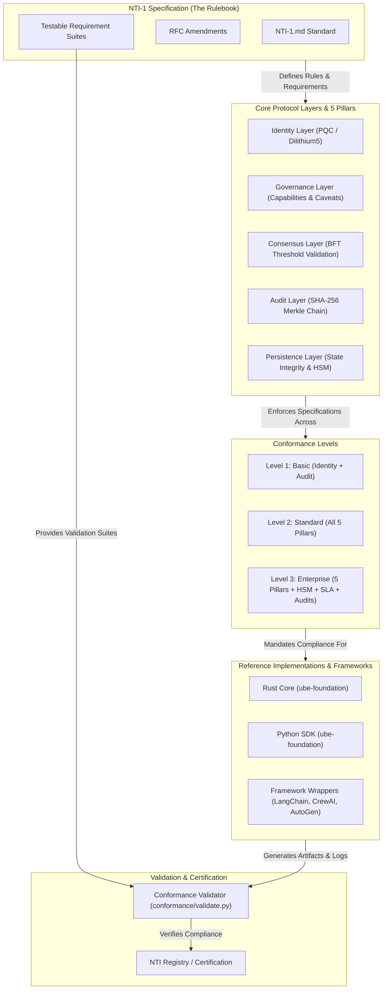

[](https://nti-registry.vercel.app)

# NTI-1 Specification

## Neutral Trust Infrastructure — Standard 1

[](https://creativecommons.org/licenses/by/4.0/)
[](./VERSION)

**Neutral Trust Infrastructure — Standard 1 (NTI-1)** is the foundational open standard for post-quantum, zero-trust governance of autonomous AI agents. NTI-1 defines formal technical requirements across five core pillars, establishing verifiable trust, non-repudiation, and BFT multi-agent consensus for enterprise deployment environments.

---

## Read the Specification

- 📄 **[NTI-1 Specification (NTI-1.md)](./NTI-1.md)** — Full specification text including requirements, RFC 2119 terminology, and testable assertion suites.
- 📜 **[RFC Amendments Folder (rfcs/)](./rfcs/)** — Active proposals, amendments, and governance discussions.
- 🧪 **[Conformance Examples (conformance/)](./conformance/)** — Official JSON examples and verification script for NTI-1 compliance testing.

---

## What NTI-1 Defines

NTI-1 specifies the **5 core pillars** that any compliant AI agent system MUST implement:

1. **Identity** — Unique, non-repudiable agent identity backed by CRYSTALS-Dilithium5 post-quantum signatures (NIST Level 5).
2. **Governance** — Zero-trust capability model enforcing granular caveats (expiration, max executions, value limits, and path restrictions).
3. **Consensus** — Byzantine Fault Tolerant (BFT) threshold decision validation for high-value multi-agent workflows.
4. **Audit** — Cryptographically tamper-evident, SHA-256 Merkle-chained event logs with exportable history.
5. **Persistence** — Self-verifying state persistence across restarts with integrity checks and HSM support.

---

## Compliance Levels

- **NTI-1 Level 1 (Basic)** — Requires Pillars 1 (Identity) and 4 (Audit). Recommended for non-critical internal tools.
- **NTI-1 Level 2 (Standard)** — Requires all 5 Pillars. Recommended for regulated production agent workflows.
- **NTI-1 Level 3 (Enterprise)** — Requires all 5 Pillars + Hardware Security Module (HSM) key storage, SOC 2 Type II, ISO 27001, and 99.99% availability SLA. Recommended for banking, healthcare, and government systems.

---

## How to Implement & Verify Compliance

### 1. Reference SDKs & Integrations

The reference SDK implementation is [`ube-foundation`](https://pypi.org/project/ube-foundation/), available on PyPI and crates.io.

Framework integrations:

- [`langchain-nti`](https://pypi.org/project/langchain-nti/) — LangChain agent governance wrappers.
- [`crewai-nti`](https://pypi.org/project/crewai-nti/) — CrewAI multi-agent BFT consensus integration.
- [`autogen-nti`](https://pypi.org/project/autogen-nti/) — AutoGen zero-trust policy enforcement.

### 2. Verify Conformance

Run the official NTI-1 conformance validator against the standard examples or your system outputs:

```bash
python3 conformance/validate.py
```

---

## Governance & Contributing

The NTI-1 specification is stewarded by the NTI Foundation and maintained under the Creative Commons Attribution 4.0 International (CC-BY-4.0) license.

Amendments are proposed via RFCs in the [rfcs/](./rfcs/) folder.

---

## License

Creative Commons Attribution 4.0 International (CC-BY-4.0).

---

## Architecture


